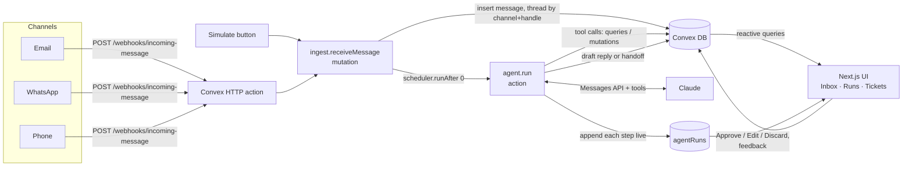

# PropInbox

A property-management inbox with a tool-using AI agent. Tenant messages arrive from email, WhatsApp and
phone. An agent built on Claude looks up the tenant, checks their unit, searches the house rules and FAQs,
opens maintenance tickets, and drafts a reply that a human approves or edits before it is sent.
Every agent run is recorded step by step, so a bad answer can be traced back to the step that caused it.

**Stack:** Convex (database, backend functions, scheduling, HTTP endpoint) · Next.js 16 · React 19 ·
TypeScript · Tailwind CSS v4 · shadcn/ui · Claude API (`@anthropic-ai/sdk`)

All data is generated. There is no real personal data in this repo.

---

## Features

### Live inbox
- Conversations from **email, WhatsApp and phone** in one list, with a thread view and a contact panel
  (tenant, unit, building, open tickets).
- **Webhook:** `POST /webhooks/incoming-message` on the Convex HTTP endpoint accepts incoming messages from
  any channel. A **"Simulate message"** button uses the same code path.
- **Live updates without refreshing.** Every view is a Convex reactive query, so new messages, agent
  progress and status changes appear as they happen.
- Senders are matched by normalised email or phone number (`0151 234…`, `+49 151 234…` and `0049…` are
  the same person), and new messages join the existing thread.

### AI agent with tools
- Each inbound message schedules a **Convex action** (`ctx.scheduler.runAfter(0, internal.agent.run)`)
  that runs a Claude tool-use loop with these tools:

  | Tool | What it does |
  |---|---|
  | `lookup_tenant` | Finds the sender, or anyone by email / phone / name (full-text search index) |
  | `get_unit_info` | Unit, building, current tenants and open tickets, so the agent doesn't open duplicates |
  | `search_knowledge_base` | Convex full-text search over house rules, FAQs and procedures, scoped to the tenant's building |
  | `create_maintenance_ticket` | Opens a ticket with category and priority (urgent = active leak, no heating, gas smell…) |
  | `draft_reply` | Ends the run with a reply and a self-reported confidence |
  | `handoff_to_human` | Ends the run with a reason, a summary and an optional suggested reply |

- **Human in the loop.** The agent only ever writes a **draft**. Staff click **Approve & send**, **Edit**, or
  **Discard**.
- **Handoff.** The conversation goes to *Needs human*, with the agent's reason and its suggested reply
  one click away, when:
  - the agent calls `handoff_to_human` (legal or money disputes, lease termination, unknown senders asking
    for private data, anything the knowledge base doesn't cover);
  - its confidence is below a threshold (default 0.7);
  - it runs out of steps;
  - the API fails.

### Agent debug view
- Every run is stored in `agentRuns`: the system prompt, the exact input transcript, **every model turn**
  (text, stop reason, tokens, latency) and **every tool call** (arguments, result, error, latency), and the
  final answer.
- Steps are written as they happen, so you can watch a run live.
- `/runs` lists all runs with:
  - handoff rate and latency / token stats;
  - the tool sequence of each run;
  - filters by outcome and feedback.
- `/runs/[id]` shows the full timeline.
- **Thumbs-down with a note.** The reviewer chooses the **step to blame** and a **root cause**
  (retrieval miss, wrong tool, bad tool arguments, missing knowledge, reasoning, tone, should have handed
  off). The blamed step is highlighted in the timeline. Root causes are counted on the runs page, so you can
  see *which kind* of failure is most common, fix it (prompt, knowledge base, or tool), mark it resolved,
  and re-run the agent on the same conversation to compare attempts.
- The seed data includes example runs, among them a bad answer caused by a poor knowledge-base search, so
  the debug view can be explored without an API key.

---

## Run it locally

You need Node.js 20+ and an [Anthropic API key](https://console.anthropic.com/settings/keys) for the agent.
Everything else works without a key.

```bash
git clone https://github.com/UsefAshraf/propinbox-ai.git
cd propinbox-ai
npm install

# 1. Create a Convex deployment (one time). Choose "start without an account" to run it locally,
#    or log in to get a free cloud deployment. This writes .env.local.
npm run setup

# 2. Add your Anthropic key to .env.local (see .env.example for optional settings)
echo "ANTHROPIC_API_KEY=sk-ant-..." >> .env.local

# 3. Start everything: the Convex backend, Next.js, and a bootstrap step that copies the key into
#    the Convex env and seeds demo data on first run
npm run dev
```

Open http://localhost:3000 and click **Simulate message**. You can watch the agent work in the thread, or
open **Agent runs** to see each step.

<details>
<summary>Useful commands</summary>

| Command | What it does |
|---|---|
| `npm run seed:reset` | Wipe and re-seed the demo data |
| `npx convex env set AGENT_DISABLED true` | Turn the agent off (messages still arrive) |
| `npx convex dashboard` | Open the Convex dashboard (data, logs, functions) |

Send a message through the webhook (use your deployment's `NEXT_PUBLIC_CONVEX_SITE_URL` from `.env.local`;
locally that's `http://127.0.0.1:3211`):

```bash
curl -X POST "$CONVEX_SITE_URL/webhooks/incoming-message" \
  -H "content-type: application/json" \
  -d '{"channel":"whatsapp","from":"+491511234567","fromName":"Test Tenant","body":"Hi, the heating in my flat stopped working"}'
```

Optional agent settings (in `.env.local`; copied into Convex by `npm run dev`): `AGENT_MODEL` (default
`claude-opus-5-5`), `AGENT_EFFORT` (default `low`), `AGENT_CONFIDENCE_THRESHOLD` (default `0.7`), and
`WEBHOOK_SECRET` (requires a matching `x-webhook-secret` header on the webhook).
</details>

---

## Architecture



- **Why the agent is an action, not a mutation.** Calling an external API isn't allowed in a Convex
  mutation, because mutations must be deterministic transactions. The action calls Claude, and every read or
  write goes through `ctx.runQuery` / `ctx.runMutation`, so each database change stays transactional.
- **Why a hand-written tool loop instead of the SDK's tool runner.** The loop writes each model turn and
  tool result to `agentRuns` *as it happens*, with timing and token counts. That data is what the debug view
  shows, and it streams to the UI through the same reactive queries as the inbox.
- **Why scheduled instead of inline.** The webhook returns at once. The agent runs in the background, and a
  newer message supersedes an older run, so only the latest run can create a draft.
- **Model settings.** `claude-opus-5-5` at `effort: "low"`, adaptive thinking, `strict: true` tool schemas,
  and a byte-stable system prompt with a cache breakpoint (today's date goes in the user message so the
  prompt cache isn't invalidated). Server-side refusal fallback is enabled (`fallbacks: "default"`).

## Data model and indexes

| Table | Purpose | Indexes (and the lookup each one serves) |
|---|---|---|
| `buildings` | Properties | `by_externalId`: upsert by source id during imports |
| `units` | Flats in a building | `by_building`: list units of a building · `by_externalId` |
| `contacts` | Tenants, owners, vendors | `by_email`, `by_phone`: match an inbound sender to a contact in O(log n) · `by_unit`: tenants of a unit (`get_unit_info`) · `by_role`: pick tenants for the simulator · `search_name` (full-text): agent looks up people by name · `by_externalId` |
| `conversations` | One thread per channel + sender | `by_channel_handle`: **thread an inbound message** onto its conversation · `by_lastMessageAt`: the inbox list, newest first · `by_status_lastMessageAt`: status tabs (Needs human, Awaiting approval…) without scanning · `by_contact` |
| `messages` | Inbound, staff, agent drafts | `by_conversation`: thread view (ordered by creation time) · `by_conversation_status`: find pending drafts to supersede or approve |
| `tickets` | Maintenance tickets | `by_unit`: open tickets per unit (duplicate check) · `by_conversation` · `by_status`: tickets page filters |
| `knowledgeBase` | House rules, FAQs, procedures | `search_body` (full-text, filter fields `category`, `buildingId`): the agent's `search_knowledge_base` tool |
| `agentRuns` | Every agent run with its full trace | `by_conversation`: latest run per thread, run history · `by_status`: runs page filter · `by_feedback_rating`: "thumbs-down, unresolved" review queue |
| `importJobs` | Bulk import progress | (looked up by id) |

Some design choices:
- Each index is shaped for a specific lookup. Compound indexes such as `status + lastMessageAt` let the
  inbox filter and sort in one indexed range read instead of filtering in memory.
- Conversations store `lastMessageAt`, `lastMessagePreview` and `unread`. The inbox list then reads one
  table instead of joining messages per row. The mutations that add messages keep these fields up to date.
- Agent steps are kept as an array on the run, not in a separate table. A run is always read as a whole, and
  it has a bounded size: at most 8 model turns, and tool results are truncated before they are stored.
- Phone numbers and emails are normalised on write (E.164, lowercase), so the indexes match exactly.

## Project structure

```
convex/
  schema.ts            tables + indexes
  http.ts              webhook endpoint
  ingest.ts            inbound message handling (shared by webhook + simulator), schedules the agent
  agent.ts             the agent action: Claude tool loop, step recording
  agentRuns.ts         run storage, tool backends, feedback, stats
  lib/agentTools.ts    tool schemas + system prompt
  conversations.ts · messages.ts · tickets.ts
  seed.ts · seedData.ts  deterministic demo data (German properties, English UI)
scripts/bootstrap.mjs  syncs .env.local agent settings into Convex and seeds on `npm run dev`
src/app/(app)/         inbox, runs (debug view), tickets
src/components/        UI components (shadcn/ui based)
```

## What I'd do next

- **Bulk CSV import with live progress.** The `importJobs` table is already in the schema. The plan:
  upload a CSV of buildings, units and tenants (5,000+ rows) to Convex file storage, then process it with a
  chain of scheduled functions, 250 rows per batch, upserting by source id (`by_externalId` indexes) so
  re-imports don't duplicate. A live progress bar and an error-row table would update reactively as each
  batch commits.
- **Evals from feedback.** Turn every thumbs-down run into a regression test (input transcript and expected
  behaviour). Run the suite on every prompt or knowledge-base change and track the pass rate over time.
- **Vector search** next to full-text search for the knowledge base (Convex vector indexes plus an
  embeddings model), so that queries like "waste" also find articles that say "rubbish".
- **Real channels.** Connect inbound email (e.g. Postmark), the WhatsApp Business API, and phone
  transcription to the existing webhook. Send approved replies back out on the same channel.
- **Auth and multi-tenancy.** Staff accounts (Convex Auth), one organisation per property manager, and
  row-level access checks in every function.
- **Ticket side effects only after approval.** Today the agent opens tickets immediately, which is useful
  for urgent repairs. A stricter mode would stage them with the draft and only create them when the draft is
  approved.
- **Streaming the draft** into the thread token by token, and cost tracking per run.
